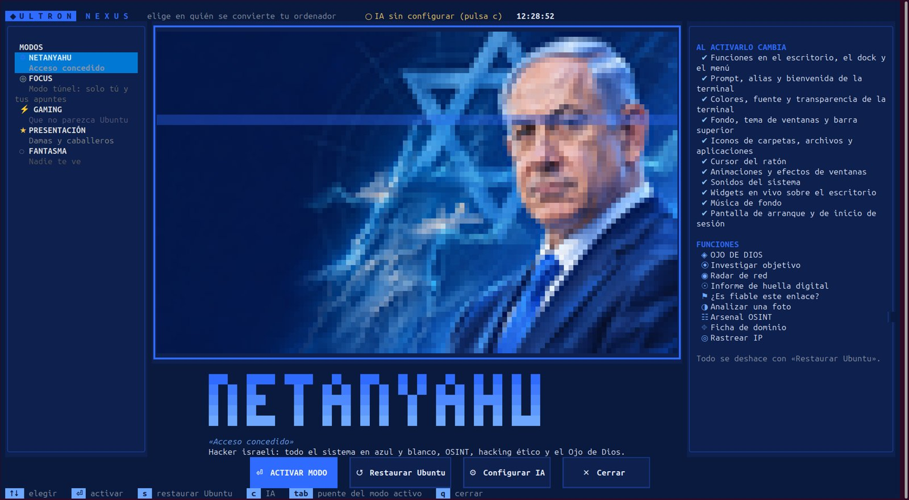
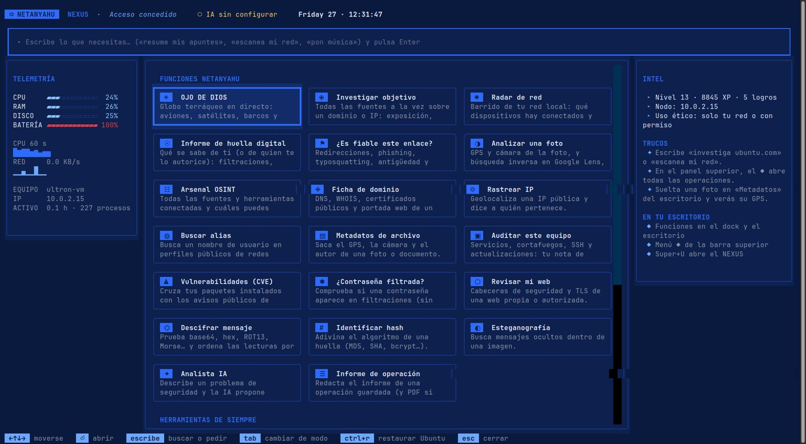
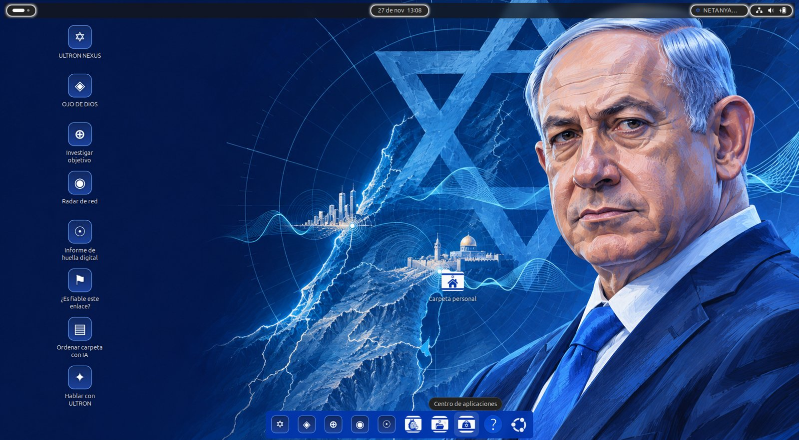
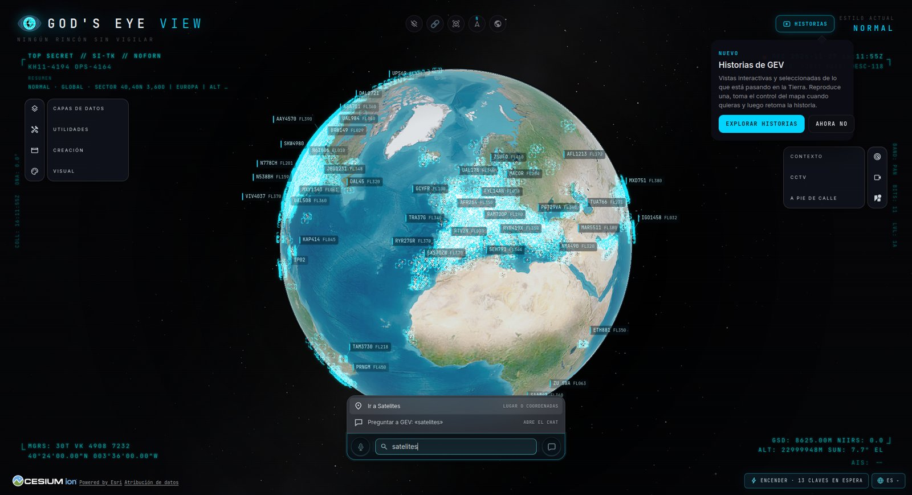
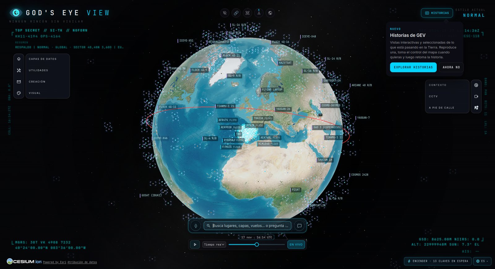
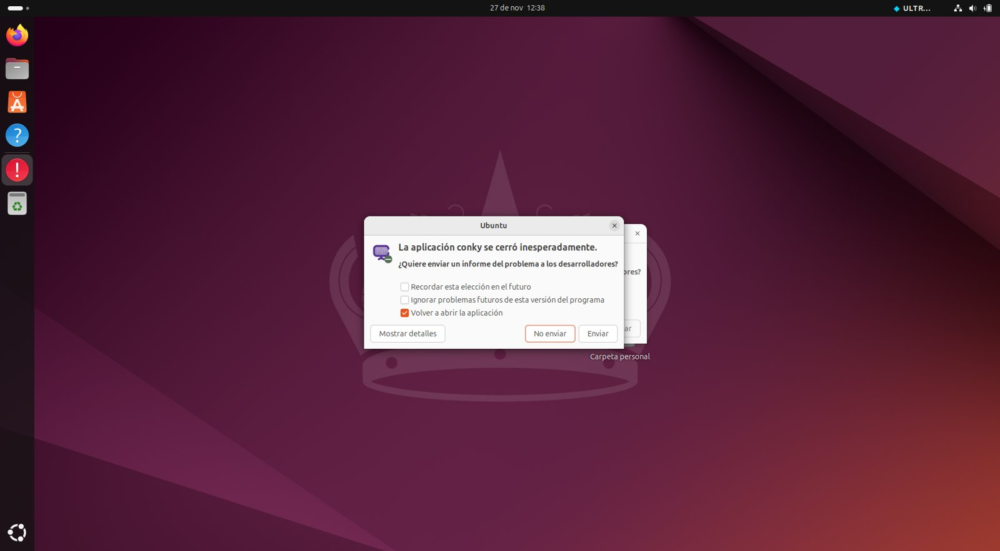

# Ultron

Ultron convierte Ubuntu 24.04+ con GNOME en cinco escritorios reversibles. Abre **NEXUS** con **Super+U** o escribe `ultron` en una terminal. Elige un modo, abre una tarjeta y rellena el formulario para usar sus herramientas sin aprender comandos. La IA es opcional.

| Modo | Qué cambia y para qué sirve |
|---|---|
| [Netanyahu](docs/modos/netanyahu.md) | Dock azul fijo abajo. Investiga enlaces y fotos, prepara informes OSINT y consulta vuelos y satélites. |
| [Focus](docs/modos/focus.md) | Barra mínima, dock izquierdo ocultable y lluvia de fondo. Bloquea distracciones, organiza el estudio y crea tarjetas desde apuntes. |
| [Gaming](docs/modos/gaming.md) | Dock fijo a la izquierda a toda altura. Abre juegos y consulta el rendimiento del equipo. |
| [Presentación](docs/modos/presentacion.md) | Dock ocultable, texto ampliado y avisos silenciados. Presenta diapositivas con cronómetro y teleprompter. |
| [Fantasma](docs/modos/fantasma.md) | Escritorio oscuro, dock ocultable y avisos silenciados. Revisa la privacidad de la conexión y limpia metadatos de fotos. |

### Capturas de una sesión real en Ubuntu

| Elegir modo | Centro de mando |
|---|---|
|  |  |
| **Escritorio Netanyahu** | **Ojo de Dios con vuelos** |
|  |  |
| **Ojo de Dios con satélites** | **Ubuntu restaurado** |
|  |  |

## Instalación

```bash
git clone https://github.com/d33alba/ultron.git
cd ultron
bash install.sh
```

El instalador usa sudo para los paquetes de Ubuntu, permite elegir modos y abre el asistente de IA. Para instalar todos los modos y configurar la IA después, usa `bash install.sh --si`. Cierra sesión y vuelve a entrar para cargar las extensiones de GNOME.

## Conectar tu IA (un solo paso)

> **Ultron no trae ninguna IA, ninguna URL ni ninguna clave.** Funciona con la tuya.
> Todo lo que no es IA funciona sin conectar nada.

**Con un servidor por API compatible con OpenAI** (el caso más habitual, también el de un
servidor de IA del centro), un único comando:

```bash
ultron ia configurar --url https://TU-SERVIDOR/v1 --modelo NOMBRE-DEL-MODELO
```

Pide la clave sin mostrarla, prueba la conexión al momento y la guarda solo para tu usuario
(`~/.config/ultron/config.toml`, permisos 600). Sin `--url` abre un asistente que pregunta
cada dato. Si el servidor usa un **certificado propio** (típico de una red interna), Ultron
lo detecta y ofrece confiar en él; también vale añadir `--sin-verificar-tls`.

Los modelos que «razonan» antes de responder (Qwen 3, DeepSeek R1…) están soportados: Ultron
oculta su razonamiento y se queda con la respuesta. Comprueba la conexión cuando quieras con
`ultron ia probar` y cambia de modelo con `ultron ia modelo NOMBRE`.

**Con una IA en el propio equipo** (Ollama o LM Studio arrancados) no hace falta configurar
nada: Ultron la detecta sola. Para elegir explícitamente:

| Servidor | Ejemplo |
|---|---|
| Ollama | `ultron ia configurar --proveedor ollama --url http://localhost:11434/v1 --modelo llama3.2` |
| LM Studio | `ultron ia configurar --proveedor lmstudio --url http://localhost:1234/v1 --modelo modelo-cargado` |
| vLLM | `ultron ia configurar --proveedor local --url http://localhost:8000/v1 --modelo modelo-servido` |
| OpenAI | `ultron ia configurar`, elige OpenAI e introduce la clave cuando se solicite. |

### Problemas frecuentes

Si el modelo no aparece, comprueba que está cargado y que la URL termina en `/v1`.
Si las extensiones aún no aparecen, vuelve a iniciar sesión en GNOME. Ejecuta
`ultron doctor --completo` para ver los requisitos pendientes y su solución.
El [manual de IA](docs/ia.md) recoge los errores y la configuración detallada.

## Cómo evaluarlo en 5 minutos

Con Ultron instalado y la sesión GNOME reiniciada, este recorrido funciona sin IA ni descargas adicionales.

1. Pulsa **Super+U**. Si ya hay un modo activo, pulsa **Tab** en el centro de mando para volver al selector. Recorre los modos con las flechas y observa cómo cambia el holograma del fondo.
2. Selecciona **Netanyahu** y pulsa **Intro**. Tras el rótulo a pantalla completa, consulta la CPU y la RAM en el centro de mando. Escribe **arsenal** en la barra y abre **Arsenal OSINT** para ver las fuentes disponibles. Pulsa **Intro** al terminar para volver.
3. Minimiza la terminal. Comprueba el dock inferior, los iconos del escritorio y el menú **◆** del panel. Abre el menú para ver las funciones del modo.
4. Vuelve a NEXUS, pulsa **Tab**, selecciona **Focus** y pulsa **Intro**. Compara su barra y su dock con los de Netanyahu. Escribe **resume mis apuntes** y abre la tarjeta de resumen para ver el formulario de archivo. **Esc** lo cierra.
5. Desde el centro de mando pulsa **Ctrl+R** para restaurar Ubuntu. Comprueba el fondo y los favoritos anteriores. También puedes restaurarlos con `ultron salir`, incluso después de un cambio interrumpido.

## Usar las funciones desde GNOME

El arranque animado de NEXUS da paso al selector o al centro de mando del modo activo. La barra en lenguaje natural busca herramientas del catálogo. Las tarjetas piden los datos necesarios, como una ruta, una dirección o una pregunta.

También puedes abrir funciones desde el escritorio, el dock o el menú de aplicaciones. Para trabajar con un documento, arrástralo al icono de una función compatible o selecciónalo en **Archivos → clic derecho → Scripts → Ultron**. Los fondos de escritorio y de bloqueo generados con GPT Images están en la carpeta `tema/` de cada modo.

## Comandos útiles

Todo se puede hacer desde NEXUS sin comandos, pero estos atajos van directos:

| Para | Comando |
|---|---|
| Abrir el centro de mando | `ultron` |
| Ver los modos | `ultron modos` |
| Entrar en un modo | `ultron entrar netanyahu` |
| Volver a Ubuntu tal como estaba | `ultron salir` |
| Que Ultron se presente solo (3 min) | `ultron exhibicion` |
| La voz de ULTRON | `ultron voz probar` |
| Silenciar la voz | `ultron voz off` |
| Ojo de Dios con vuelos y satélites | `ultron ojo abrir` |
| Investigar un dominio o una IP | `ultron osint operacion ubuntu.com --mapa` |
| ¿Es fiable un enlace? | `ultron osint url http://ejemplo.xyz/login` |
| Fuentes OSINT conectadas | `ultron osint fuentes` |
| Revisar la seguridad del equipo | `ultron auditar` |
| Resumir unos apuntes | **ultron resumen** seguido del PDF o los apuntes |
| Crear flashcards | **ultron flashcards crear** seguido del documento |
| Ordenar Descargas con IA | `ultron ordenar` |
| Preguntar a la IA | `ultron ia preguntar "¿Qué es un pomodoro?"` |
| Comprobar la conexión con la IA | `ultron ia probar` |
| Música de un modo | `ultron musica importar cancion.mp3 --modo netanyahu` |
| Diagnóstico completo | `ultron doctor --completo` |

## Manuales y ejemplos

- [Configuración de IA](docs/ia.md), [arquitectura](docs/arquitectura.md) y [pruebas de desarrollo](docs/desarrollo.md).
- Ejemplos de salida en terminal de [Radar](docs/media/radar.svg), [repaso](docs/media/repasar.svg), [HUD](docs/media/hud.svg) y [diapositivas](docs/media/diapos.svg).
- Para desinstalar el programa después de restaurar Ubuntu, ejecuta `bash uninstall.sh` desde el repositorio.
- [Licencia MIT](LICENSE) y [créditos de terceros](docs/creditos.md).
