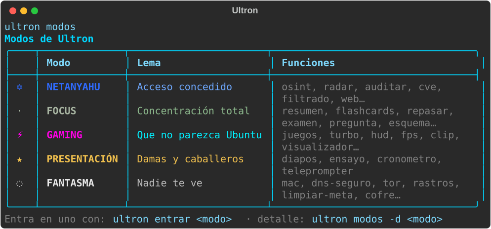
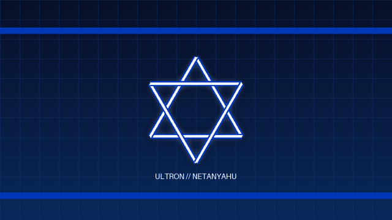
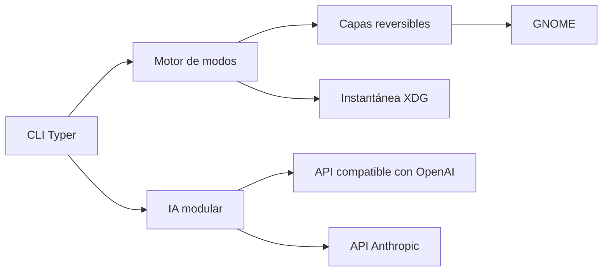

# Ultron

```text
 _   _ _   _____ ____   ___  _   _
| | | | | |_   _|  _ \ / _ \| \ | |
| | | | |   | | | |_) | | | |  \| |
| |_| | |___| | |  _ <| |_| | |\  |
 \___/|_____|_| |_| \_\\___/|_| \_|
```

**Un escritorio para cada misión.**

[](https://github.com/d33alba/ultron/actions/workflows/ci.yml)


## ¿Qué es?

Ultron transforma Ubuntu con GNOME en cinco escritorios especializados.
Cada modo cambia la terminal, combina capas visuales y aporta sus propias herramientas.
Puedes conectar una IA local, probar los ejemplos y restaurar el escritorio desde la misma CLI.

| Glifo | Modo | Estética | Funciones estrella |
|---|---|---|---|
| ✡ | [Netanyahu](docs/modos/netanyahu.md) | Azul y blanco, centro de operaciones | `ultron radar --demo`, `ultron osint ip 8.8.8.8 --demo` |
| ◑ | [Focus](docs/modos/focus.md) | Papel, tinta y verde salvia | `ultron repasar --demo`, `ultron stats --demo` |
| ⚡ | [Gaming](docs/modos/gaming.md) | Neón y visualización de rendimiento | `ultron juegos --demo`, `ultron hud --demo --una-vez` |
| ▶ | [Presentación](docs/modos/presentacion.md) | Alto contraste y tipografía grande | `ultron diapos --demo`, `ultron cronometro --demo` |
| ◇ | [Fantasma](docs/modos/fantasma.md) | Oscuro y discreto | `ultron mac --demo`, `ultron dns-seguro --demo` |




Capturas reproducibles en `docs/media/`: [radar.svg](docs/media/radar.svg),
[osint-ip.svg](docs/media/osint-ip.svg), [stats.svg](docs/media/stats.svg),
[repasar.svg](docs/media/repasar.svg), [hud.svg](docs/media/hud.svg),
[diapos.svg](docs/media/diapos.svg) y [mac.svg](docs/media/mac.svg). También se generan
`banner-<modo>.svg` y `fondos/<modo>.png` con `python scripts/capturas.py`.

## Instalación en tres comandos

```bash
git clone https://github.com/d33alba/ultron.git
cd ultron
bash install.sh
```

El instalador pide permiso para usar sudo, deja elegir modos y abre el asistente de IA.
Cierra sesión y vuelve a entrar una vez para que GNOME cargue las extensiones. Abre el
selector con `ultron` o **Super+U**.

## Configurar tu IA

Inicia el servidor, carga un modelo y usa el proveedor y la URL de la tabla. Sustituye
los nombres de ejemplo por los que ofrece tu servidor.

| Servidor | Ejemplo |
|---|---|
| Ollama | `ultron ia configurar --proveedor ollama --url http://localhost:11434/v1 --modelo llama3.2` |
| LM Studio | `ultron ia configurar --proveedor lmstudio --url http://localhost:1234/v1 --modelo modelo-cargado` |
| vLLM | `ultron ia configurar --proveedor local --url http://localhost:8000/v1 --modelo modelo-servido` |
| OpenAI | `ultron ia configurar`, elige OpenAI e introduce la clave cuando se solicite. |

### Problemas frecuentes

Si el modelo no aparece, comprueba que está cargado y que la URL termina en `/v1`.
Si las extensiones aún no aparecen, vuelve a iniciar sesión en GNOME. Ejecuta
`ultron doctor --completo` para ver los requisitos pendientes y su solución.
El [manual de IA](docs/ia.md) recoge los errores y la configuración detallada.

## Primeros pasos

```bash
ultron demo
ultron modos --detalle focus
ultron entrar focus --simular
ultron entrar focus
ultron estado
```

`ultron demo --rapida` enseña un ejemplo por modo en menos de tres minutos y funciona
sin conexión ni IA. `ultron ia probar` verifica la conexión por separado.

## Deshacer todo

Ejecuta `ultron salir` para restaurar las capas a partir de la instantánea. Incluso si
se interrumpió el cambio de modo, puedes ejecutar la misma orden. Para quitar también el
programa instalado por pipx, ejecuta `bash uninstall.sh` desde el repositorio.

## Arquitectura



## Seguridad y ética

Utiliza OSINT con información pública y limita las comprobaciones de seguridad a
equipos y redes propios o con permiso. Las capas capturan los valores originales antes
de modificarlos. Ultron avisa antes de pedir sudo y admite `ultron entrar focus --sin-sudo`.
Los comandos generados por IA requieren confirmación. Ultron carece de telemetría.

El código se distribuye bajo [licencia MIT](LICENSE). Consulta los [créditos y licencias
de terceros](docs/creditos.md) para God's Eye View, Yaru y las extensiones de GNOME.
